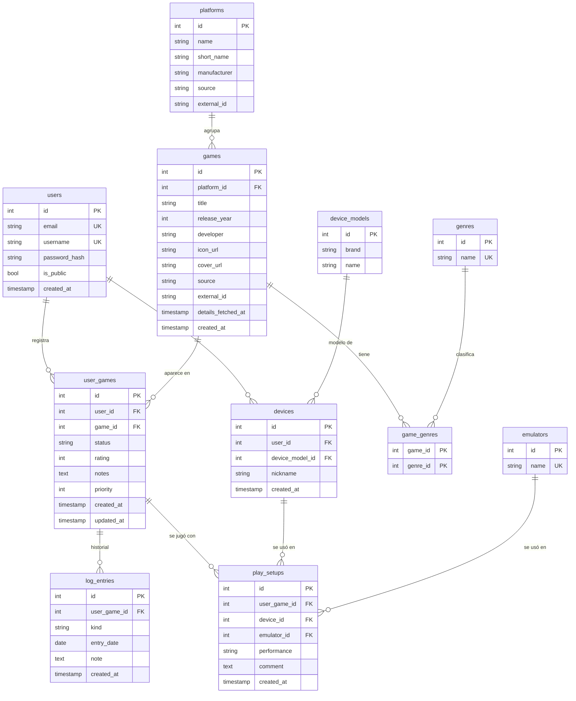

# Diseño de la base de datos (v0.1)

Base de datos: PostgreSQL. Este documento cubre las historias H1 a H10.

## Principio de diseño

Todo lo que varios usuarios comparten y por lo que más adelante se querrá agrupar o filtrar (consolas, juegos, géneros, modelos de dispositivo, emuladores) vive en su propia tabla de catálogo. Los datos personales de cada usuario apuntan a esos catálogos. Así, funciones futuras como "qué juegos corren bien en mi dispositivo" (v0.3) se resuelven con consultas, no con migraciones.

## Diagrama

## Catálogos compartidos

Datos iguales para todos los usuarios. Los usuarios los leen; los cargamos nosotros (con scripts o desde la API).

### platforms
Consolas (SNES, Game Boy Advance, Mega Drive...).

| Columna | Tipo | Reglas |
|---|---|---|
| id | serial | Clave primaria |
| name | varchar(100) | Obligatorio. Ej.: "Super Nintendo Entertainment System" |
| short_name | varchar(20) | Ej.: "SNES" |
| manufacturer | varchar(50) | Ej.: "Nintendo" |
| source | varchar(30) | De dónde vino. Ej.: "retroachievements" |
| external_id | varchar(50) | ID en la fuente |

Restricción: `(source, external_id)` único.

### games
El catálogo de juegos. Un juego existe una sola vez, sin importar cuántos usuarios lo registren (H2, H3).

| Columna | Tipo | Reglas |
|---|---|---|
| id | serial | Clave primaria |
| platform_id | int | Clave foránea a `platforms.id`, obligatorio |
| title | varchar(255) | Obligatorio, con índice para búsquedas |
| release_year | smallint | Opcional |
| developer | varchar(150) | Opcional |
| icon_url | varchar(500) | Opcional |
| cover_url | varchar(500) | Opcional |
| source | varchar(30) | Ej.: "retroachievements" |
| external_id | varchar(50) | ID del juego en la fuente |
| details_fetched_at | timestamptz | `null` = todavía no se pidieron los detalles a la API (caché perezosa) |
| created_at | timestamptz | Por defecto `now()` |

Restricción: `(source, external_id)` único, para no importar el mismo juego dos veces.

Nota: el mismo juego en dos consolas (por ejemplo, la versión de SNES y la de GBA) son dos filas distintas, porque son versiones diferentes.

### genres y game_genres
Un juego puede tener varios géneros y un género tiene muchos juegos: relación muchos a muchos.

`genres`

| Columna | Tipo | Reglas |
|---|---|---|
| id | serial | Clave primaria |
| name | varchar(50) | Único, obligatorio. Ej.: "Plataformas" |

`game_genres` (tabla intermedia)

| Columna | Tipo | Reglas |
|---|---|---|
| game_id | int | Clave foránea a `games.id` |
| genre_id | int | Clave foránea a `genres.id` |

Clave primaria compuesta: `(game_id, genre_id)`.

### device_models
Modelos de dispositivo (Retroid Pocket 5, Anbernic RG35XX...). Lista compartida para que todos usen el mismo nombre.

| Columna | Tipo | Reglas |
|---|---|---|
| id | serial | Clave primaria |
| brand | varchar(50) | Obligatorio. Ej.: "Retroid" |
| name | varchar(100) | Obligatorio. Ej.: "Retroid Pocket 5" |

Restricción: `(brand, name)` único.

### emulators
Emuladores (RetroArch Snes9x, PPSSPP, DuckStation...). Lista compartida por la misma razón.

| Columna | Tipo | Reglas |
|---|---|---|
| id | serial | Clave primaria |
| name | varchar(100) | Único, obligatorio. Ej.: "RetroArch (Snes9x)" |

## Datos de cada usuario

### users
Cuentas de usuario (H1).

| Columna | Tipo | Reglas |
|---|---|---|
| id | serial | Clave primaria |
| email | varchar(255) | Obligatorio. Se guarda siempre en minúsculas y es único. Sirve solo para iniciar sesión y nunca se muestra a otros usuarios |
| username | varchar(30) | Obligatorio. Nombre público que elige el usuario (3 a 30 caracteres: letras, números, `_` y `-`). Único sin distinguir mayúsculas |
| password_hash | varchar(255) | Obligatorio. Nunca se guarda la contraseña en texto plano |
| is_public | boolean | Por defecto `false`. Se usará en la v0.2, pero se crea desde ya |
| created_at | timestamptz | Por defecto `now()` |

### user_games
La relación entre un usuario y un juego: el estado actual de "tu" juego (H4, H5, H7).

| Columna | Tipo | Reglas |
|---|---|---|
| id | serial | Clave primaria |
| user_id | int | Clave foránea a `users.id`, obligatorio. Si se borra el usuario, se borran sus registros |
| game_id | int | Clave foránea a `games.id`, obligatorio |
| status | enum | `playing`, `backlog`, `completed`, `dropped` |
| rating | smallint | Opcional, de 1 a 10 (equivale a media estrella a cinco estrellas) |
| notes | text | Opcional, privada |
| priority | smallint | Opcional, de 1 (alta) a 3 (baja). Tiene sentido sobre todo en `backlog` |
| created_at | timestamptz | Por defecto `now()` |
| updated_at | timestamptz | Se actualiza en cada cambio |

Restricciones:
- `(user_id, game_id)` único: un usuario no puede tener el mismo juego dos veces en su registro.
- `rating` entre 1 y 10 si no es `null`.

### log_entries
El historial: qué pasó con un juego y cuándo (H6, H9). `user_games` dice dónde estás ahora; `log_entries` cuenta el camino.

| Columna | Tipo | Reglas |
|---|---|---|
| id | serial | Clave primaria |
| user_game_id | int | Clave foránea a `user_games.id`, obligatorio |
| kind | enum | `started`, `completed`, `dropped`, `replayed`, `note` |
| entry_date | date | Obligatorio. Fecha del evento (puede ser pasada) |
| note | text | Opcional |
| created_at | timestamptz | Por defecto `now()` |

Regla de negocio: al agregar un juego o cambiar su `status` en `user_games`, el backend crea la entrada de historial que indica esta tabla. La fecha (`entry_date`) es la que envía el usuario en `status_date`; si no la envía, es la de hoy.

| Estado anterior | Estado nuevo | Entrada creada |
|---|---|---|
| (juego nuevo) | `backlog` | ninguna |
| (juego nuevo) | `playing` | `started` |
| (juego nuevo) | `completed` | `completed` |
| (juego nuevo) | `dropped` | `dropped` |
| `backlog` | `playing` | `started` |
| `backlog` | `completed` | `completed` |
| `backlog` | `dropped` | `dropped` |
| `playing` | `completed` | `completed` |
| `playing` | `dropped` | `dropped` |
| `playing` | `backlog` | ninguna |
| `completed` | `playing` | `replayed` |
| `completed` | `dropped` | `dropped` |
| `completed` | `backlog` | ninguna |
| `dropped` | `playing` | `started` |
| `dropped` | `completed` | `completed` |
| `dropped` | `backlog` | ninguna |
| cualquiera | el mismo | ninguna |

Las entradas de tipo `note` solo se crean a mano, con `POST /me/games/{id}/log`.

### devices
Los dispositivos de cada usuario (H8).

| Columna | Tipo | Reglas |
|---|---|---|
| id | serial | Clave primaria |
| user_id | int | Clave foránea a `users.id`, obligatorio |
| device_model_id | int | Clave foránea a `device_models.id`, obligatorio |
| nickname | varchar(100) | Opcional. Ej.: "La morada" |
| created_at | timestamptz | Por defecto `now()` |

### play_setups
En qué dispositivo y con qué emulador se jugó un juego del registro, y cómo corrió (H8).

| Columna | Tipo | Reglas |
|---|---|---|
| id | serial | Clave primaria |
| user_game_id | int | Clave foránea a `user_games.id`, obligatorio |
| device_id | int | Clave foránea a `devices.id`, obligatorio |
| emulator_id | int | Clave foránea a `emulators.id`, opcional (puede ser un port nativo) |
| performance | enum | `perfect`, `playable`, `issues`, `unplayable` |
| comment | text | Opcional |
| created_at | timestamptz | Por defecto `now()` |

Regla: `device_id` debe pertenecer al mismo usuario que `user_game_id`. Se valida en el backend.

## Lo que no necesita tabla

- **Estadísticas (H9):** consultas sobre `user_games` y `log_entries`. Por ejemplo, terminados por año = entradas `completed` agrupadas por año de `entry_date`; por consola = `user_games` unido con `games` y `platforms`.
- **"¿Qué juego ahora?" (H10):** consulta sobre `user_games` con `status = 'backlog'`, eligiendo al azar con más peso para la prioridad alta.

## Decisiones tomadas

1. **Historial en `log_entries`**, separado del estado actual. Permite rejugadas, historial completo y estadísticas por año. Se quitaron `started_on` y `finished_on` de `user_games` para no guardar el mismo dato en dos lugares.
2. **`device_models` y `emulators` como catálogos compartidos.** Evitan duplicados ("RP5" frente a "Retroid Pocket 5") y dejan lista la agregación de la v0.3.
3. **Géneros en tabla propia con relación muchos a muchos**, porque un juego puede tener varios y H2 pide filtrar por género.
4. **Catálogo de dispositivos y emuladores cargado por nosotros.** Se arranca con una lista corta de los más usados y se amplía a pedido de los usuarios. No se intenta cubrir todo el mercado desde el inicio.
5. **Correo en minúsculas y username público.** El correo se normaliza a minúsculas para que `Ana@mail.com` y `ana@mail.com` no sean cuentas distintas. El username es un nombre público independiente del correo.

## Reglas de borrado

| Se borra | Qué pasa con lo que depende de él |
|---|---|
| Un usuario | Se borra todo lo suyo: registro, historial, dispositivos y configuraciones |
| Un juego de mi registro (`user_games`) | Se borran su historial y sus configuraciones |
| Un dispositivo | No se puede si tiene configuraciones asociadas (409). Hay que borrarlas o reasignarlas antes, para no perder ese dato por accidente |
| Un juego, plataforma, género, modelo o emulador del catálogo | No se borran desde la API; solo los administra el equipo |

## Pendiente

- **Búsqueda por título (H2):** un índice normal no acelera búsquedas del tipo "contiene". Al implementar H2 se evaluará la extensión `pg_trgm` de PostgreSQL.
